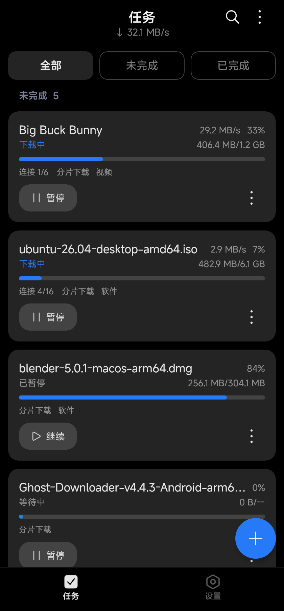
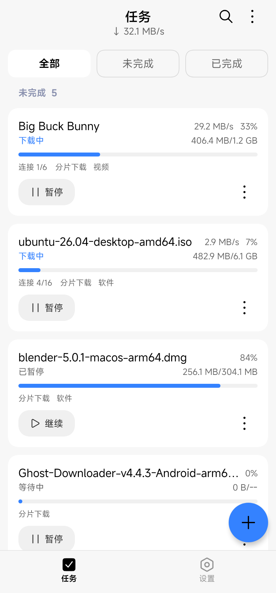
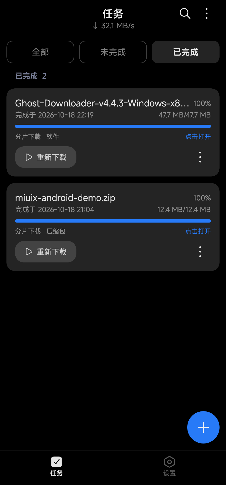
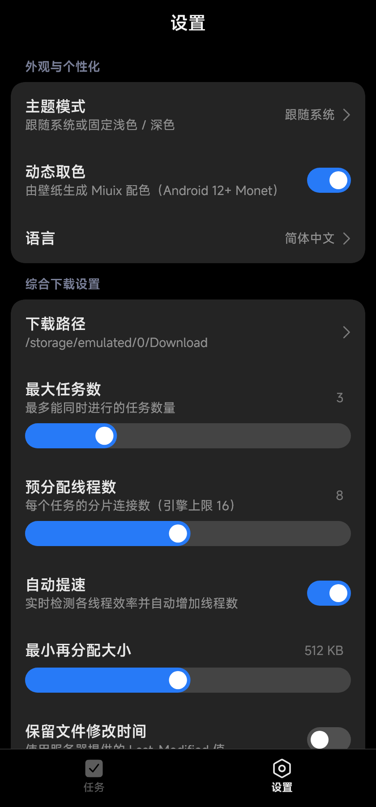
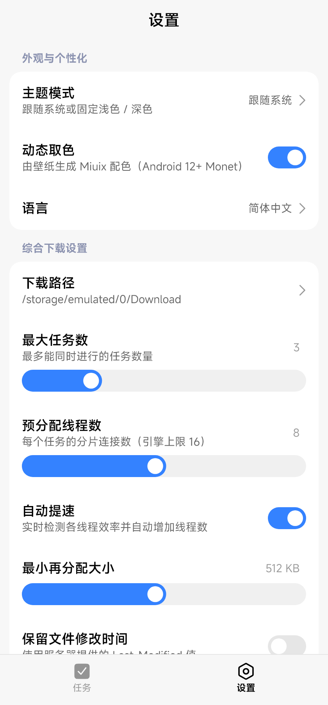
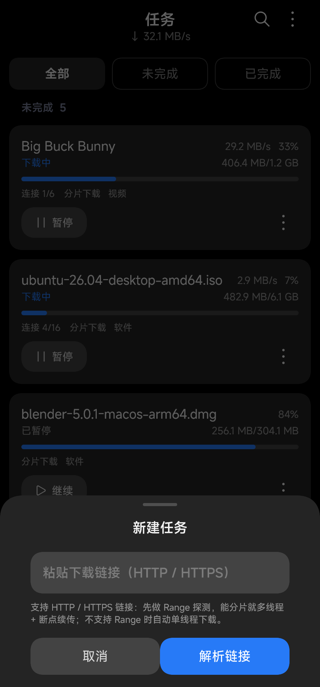
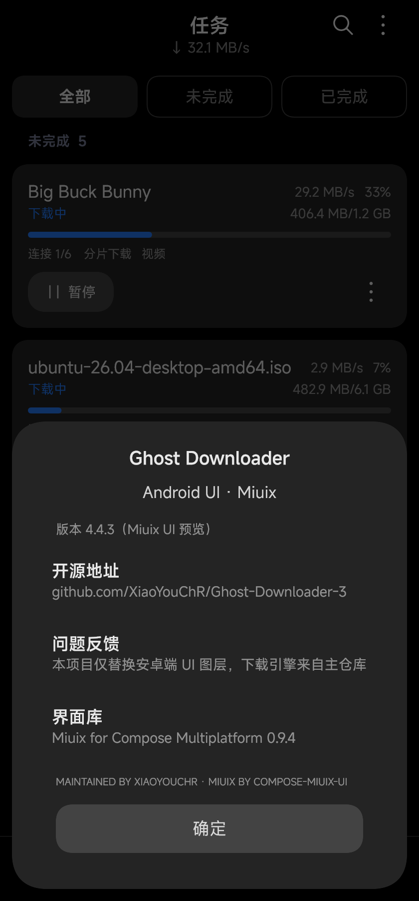

# Ghost Downloader · Miuix Android UI

把 Ghost Downloader 的安卓端界面从 **Material Design (Material 3)** 换成小米 **Miuix (HyperOS)** 材质，
并内置了一套**可真正下载的 HTTP/HTTPS 引擎**，让这个安卓端不再只是界面原型。

> 这个模块是 `Ghost-Downloader-3` 仓库里新增的安卓 UI 层（`android-miuix/`），与桌面端 Qt 界面完全解耦：
> 同一套 Compose 界面既能打成 Android APK，也能在 Desktop 上以手机比例预览、截图、跑引擎冒烟测试。

---

## 为什么是独立模块？

上游 v4.4.3 的安卓端 UI 并不在本仓库里：

* 主仓库只包含 Python 引擎 + 桌面端 PySide6/Qt UI；
* 安卓 APK 由 CI 检出**私有仓库** `XiaoYouChR/Ghost-Downloader-Android`（Kotlin + Jetpack Compose Material3 +
  Chaquopy）后构建，`android/` 目录已于 2026-09-08 从公开仓库移除（`refactor: remove Qt Android`）。

因此本模块用 **官方 Miuix for Compose Multiplatform** 重新实现了安卓 UI 层：
组件、配色、圆角、间距、动效全部换成 HyperOS 风格。

上游 Python 引擎无法直接嵌入：它依赖 `wreq`（Rust TLS 指纹）与 `libtorrent`，两者都需要为
Android arm64 交叉编译的 wheel（私有仓库的 `build-scripts` 才会产出）。所以这里用 **Kotlin + OkHttp**
实现了同一套下载语义（HTTP/HTTPS 多线程分块、Range 断点续传、并发上限、同名冲突、任务持久化），
UI 与引擎通过 `state/AppState.kt` 解耦——将来接入 Chaquopy/Python 引擎时只换数据来源即可。

## 目录结构

```
android-miuix/
├── app/                        # Android APK 模块（AGP 9 内置 Kotlin）
│   └── src/main/
│       ├── kotlin/.../MainActivity.kt      # 创建引擎 + 沉浸式状态栏 + setContent { App() }
│       ├── kotlin/.../platform/            # FileProvider 打开文件
│       ├── res/                            # 图标 / 应用名 / 窗口主题 / FileProvider paths
│       └── AndroidManifest.xml             # INTERNET / ACCESS_NETWORK_STATE / FileProvider
├── preview/                    # Desktop 预览模块（Compose Multiplatform + JVM）
│   └── src/
│       ├── main/kotlin/.../Main.kt         # 420x900 手机比例窗口，可直接用真实引擎下载
│       ├── main/kotlin/.../Screenshot.kt   # 无窗口渲染截图
│       ├── main/kotlin/.../SmokeDownload.kt# 无 GUI 下载冒烟测试
│       ├── main/kotlin/.../platform/       # Desktop 打开文件
│       └── test/kotlin/.../engine/         # 本地 Range 服务器集成测试
├── shared-ui/src/...           # 两端共用的全部代码
│   ├── App.kt                  # 根组件 / 主题 / 500ms 引擎轮询
│   ├── engine/                 # 下载引擎：HttpDownloadEngine / TaskStore / Model
│   ├── platform/               # PlatformFiles 抽象（打开文件）
│   ├── theme/                  # MiuixTheme + Monet 动态取色
│   ├── model/                  # Task / TaskStatus / 演示数据
│   ├── state/                  # AppState（真实引擎 / 演示模式）/ AppSettings
│   ├── util/                   # 尺寸 / 速度 / 百分比格式化
│   └── ui/                     # 界面：外壳 / 任务列表 / 设置 / 新建任务 / 关于
└── gradle/libs.versions.toml   # 版本目录
```

## 下载引擎

引擎按开发者文档《下载引擎》《任务系统》与上游 `features/http_pack/task.py` 的语义实现：

| 能力 | 实现 |
| --- | --- |
| Range 探测 | 两阶段：先 `bytes=1-1` 偏移探测（区分「支持 Range」与「忽略 Range」），200 且长度未知/为 1 时回退 `bytes=0-0`；206/416 的 `content-range` 取总大小 |
| 三种下载模式 | `206 + content-range` → 分片多线程；`200 + content-length` → 单线程（重试截断重下）；`200 无 content-length` → 单线程（重试从当前位置续写） |
| 分片（Subworker） | 按 `subworkerCount` 等分 byte-range，并行 Range 请求定位写入同一文件；分片完成后**接管剩余量最大分片的后半段**，尾部不空等 |
| 断点续传 | 进度文件 `{成品路径}.ghd`（与上游一致的二进制格式：24 字节小端 `start/position/end`），每秒落盘，暂停/退出时也会写 |
| 暂停 / 继续 | 取消协程与 OkHttp Call，保留 `.ghd`；继续时长任务从各分片偏移续传 |
| 运行时降级 | 分片过程中服务器返回 200（CDN 切换/策略变化）→ 截断文件、删进度、自动改单线程重下 |
| 自动加速 | 每秒采样，连续 5 个样本偏差 < 15% 时拆 4 个分片；5 秒后比较「速度增益 / 并行增益」，≥ 80% 继续、否则本次下载永久停止加速（可在设置关闭） |
| 调度 | 有序等待队列 + 最大并发；降低并发数时把超出的可暂停任务取消回等待队列 |
| 任务持久化 | `tasks.jsonl`（JSONL，200ms 防抖 + 临时文件原子重命名）；重启后等待/运行中的任务自动入队，失败/暂停保持原状 |
| 错误策略 | 临时错误（超时/断线）每 5 秒重试并在卡片上显示重试次数；永久错误 `400/401/403/404/405/410/451` 直接失败 |
| 同名冲突 | 同时检查内存任务、磁盘成品、磁盘 `.ghd`；保留两者自动加 `(1)`，或覆盖 |
| 文件打开 | Android 用 `FileProvider` + `ACTION_VIEW`；Desktop 用 `java.awt.Desktop` |
| 进度与速度 | 监管协程每秒汇总分片字节、计算速度与自动加速；UI 500ms 轮询快照，未知大小显示不确定进度条 |

下载目录：

* Android：`/storage/emulated/0/Android/data/<应用包名>/files/Download`（API 26+ 无需存储权限）；
* Desktop：`~/Downloads/GhostDownloader`（任务记录 `~/.ghostdownloader`）。

已实现的操作：新建任务（真实探测）、暂停 / 继续、重试、**重新下载**（删成品与进度后从头开始）、
删除任务（保留文件 / 同时删文件）、打开文件、打开所在文件夹、全部开始 / 全部暂停、
按名称搜索、全部/未完成/已完成筛选。

## Material 3 → Miuix 对照表

| 原 Material 3（当前安卓端） | 本模块的 Miuix 组件 |
| --- | --- |
| `MaterialTheme` / `MaterialTheme.colorScheme` | `MiuixTheme(controller = ThemeController(...))` / `MiuixTheme.colorScheme` |
| Material You 动态取色 | `ColorSchemeMode.MonetSystem / MonetLight / MonetDark` |
| `TopAppBar` / `CenterAlignedTopAppBar` | `SmallTopAppBar`（标题 + 副标题 + actions + bottomContent） |
| `NavigationBar` + `NavigationBarItem` | `NavigationBar` + `NavigationBarItem`（HyperOS 胶囊/图标文字模式） |
| `FloatingActionButton` | `FloatingActionButton` |
| `Card` / `ElevatedCard` | `Card`（`surfaceContainer`、16dp 圆角、`insideMargin`） |
| `Button` / `FilledTonalButton` | `Button` + `ButtonDefaults.buttonColors()` / `buttonColorsPrimary()` |
| `ListItem` / `Switch` / `Slider` 行 | `BasicComponent` / `ArrowPreference` / `SwitchPreference` / `SliderPreference` |
| `AlertDialog` | `OverlayDialog` |
| `ModalBottomSheet` | `OverlayBottomSheet` |
| `FilterChip` / `SegmentedButton` | `TabRow` |
| `LinearProgressIndicator` | `LinearProgressIndicator` |
| `SnackbarHost` / `SnackbarHostState` | 同名 Miuix 组件 |
| `Icons.*` / Material Icons | `MiuixIcons` + `top.yukonga.miuix.kmp.icon.extended.*`（156 个 HyperOS 图标） |
| 字体：Roboto / Material Typography | `MiuixTheme.textStyles`（HyperOS 字号体系） |

## 已实现界面

1. **任务列表**：未完成 / 已完成分组、全部/未完成/已完成 `TabRow` 过滤、搜索、实时速度副标题、
   下载卡片（进度条、速度、连接数、大小、错误提示）、暂停/继续/重试胶囊按钮、
   「更多」底部弹层（打开文件 / 打开文件夹 / 删除任务 / 删除并清理文件）、
   右下角 FAB、底部 `NavigationBar`、Snackbar 提示；已完成卡片点击即打开文件。
2. **设置**：外观与个性化（主题模式 / 动态取色 / 语言）、综合下载设置（下载路径、最大任务数、
   预分配线程数、自动提速、最小再分配大小、保留修改时间、SSL 校验、同名文件、系统 DNS）、
   下载分类、浏览器扩展（端口 / 配对令牌）、应用（自动更新 / 关于）；其中
   「最大任务数」「预分配线程数」「同名文件」已实际作用到下载引擎。
3. **新建任务**：粘贴链接 → 引擎探测（文件名 / 大小 / 是否支持续传）→ 文件名 / 保存路径 / 分类 → 开始下载。
4. **关于**：版本信息、开源地址、界面库信息。
5. **主题**：浅色 / 深色 / 跟随系统 + Monet 动态取色，状态栏与导航栏沉浸式透明。

## 截图

> 由 `gradlew :preview:screenshot` 无窗口渲染（420x900dp @2x），不受本机 DPI / 窗口装饰影响。

| 任务列表（深色） | 任务列表（浅色） | 已完成 / 失败 |
| --- | --- | --- |
|  |  |  |

| 设置（深色） | 设置（浅色） | 新建任务 | 关于 |
| --- | --- | --- | --- |
|  |  |  |  |

## 构建

环境要求：**JDK 21**、Android SDK（`platforms;android-37.0`、`build-tools;37.0.0`）。本机已安装在：

```
E:\dev\jdk21
E:\dev\android-sdk
```

```powershell
$env:JAVA_HOME = "E:\dev\jdk21"
$env:ANDROID_HOME = "E:\dev\android-sdk"
$env:ANDROID_SDK_ROOT = "E:\dev\android-sdk"

cd android-miuix

# 1) 打安卓 APK
.\gradlew.bat :app:assembleDebug
# 产物：app\build\outputs\apk\debug\app-debug.apk

# 2) 桌面预览（420 x 900，效果与安卓一致，可直接用内置引擎下载）
.\gradlew.bat :preview:run

# 3) 无窗口渲染 README 截图（输出到 android-miuix/screenshots/）
.\gradlew.bat :preview:screenshot

# 4) 引擎集成测试（本地 Range 服务器：分块 / 暂停继续 / 持久化 / 非法协议）
.\gradlew.bat :preview:test

# 5) 真实网络下载冒烟测试（打印探测、进度、完成路径）
.\gradlew.bat :preview:engineSmoke
.\gradlew.bat :preview:engineSmoke "-Purl=https://speed.cloudflare.com/__down?bytes=5000000"
```

Gradle 发行版走腾讯镜像（见 `gradle/wrapper/gradle-wrapper.properties`），依赖仓库优先走阿里云镜像，
Miuix 0.9.4 从 Maven Central 拉取。

## 版本

| 组件 | 版本 |
| --- | --- |
| Miuix (`top.yukonga.miuix.kmp:*`) | 0.9.4 |
| Compose Multiplatform | 1.12.2 |
| Kotlin | 2.4.21 |
| OkHttp（下载引擎） | 5.5.0 |
| AGP | 9.4.1 |
| Gradle | 9.8.2 |
| compileSdk / targetSdk / minSdk | 37 / 37 / 26 |

## 已知限制

* 内置引擎目前只支持 **HTTP / HTTPS**；磁力、BT、FTP、m3u8 等协议仍需要上游 Python 引擎
  （`wreq` / `libtorrent` 的 Android arm64 wheel 目前只在私有仓库的构建脚本里）；
* 不支持 Range 的服务器（单流模式）不可断点续传：暂停后再次开始会从头下载（与上游 `canPause` 一致）；
* 下载运行在 App 进程内，进程被系统杀死时会暂停（任务记录已持久化，重开 App 后自动恢复等待/运行中的任务）；
  尚未接前台 Service / 通知栏进度；
* 未实现全局限速 / 代理 / 指纹 Client（对应上游 SpeedMeter、wreq），这些属于后续可选项；
* Android 端「打开所在文件夹」返回 false（系统没有通用目录 Intent），UI 会提示下载路径；
* 演示截图仍使用 `AppState(demo = true)` 的模拟任务，真实 App 使用内置引擎；
* 上游真实安卓 UI 源码为私有仓库，本模块是公开仓库中可维护的替代实现。
